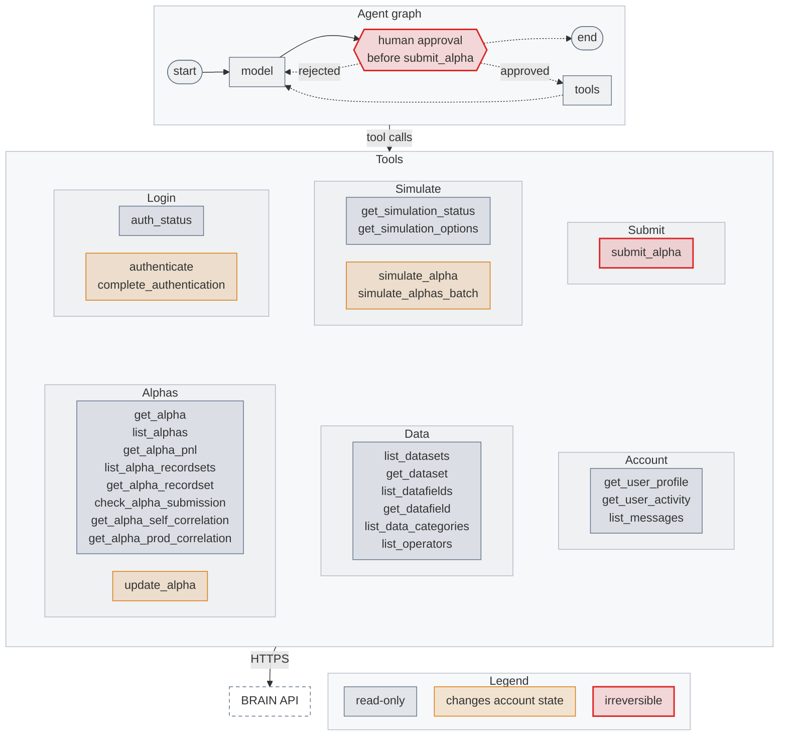

<!-- mcp-name: io.github.tukorama/mcp-server-worldquantbrain -->

# mcp-server-worldquantbrain

[](https://pypi.org/project/mcp-server-worldquantbrain/)
[](https://github.com/tukorama/mcp-server-worldquantbrain/actions/workflows/ci.yml)
[](LICENSE)

An MCP server and LangGraph toolkit for [WorldQuant BRAIN](https://platform.worldquantbrain.com).
It lets an agent look up data fields, backtest FASTEXPR alphas and read the results. Unofficial, and
not affiliated with WorldQuant.

## Why this exists

Driving BRAIN from an agent goes wrong in a few predictable ways, and each one shaped this package.

- **A simulation takes minutes and clients give up sooner.** A wait that runs out returns `PENDING`
  with an id, and `get_simulation_status` picks it up again. Nothing is resubmitted.
- **Agents repeat themselves, and simulations are metered.** A local ledger remembers every
  expression and settings pair, so a repeat returns the earlier alpha instead of spending quota.
- **BRAIN responses are huge.** Tools return trimmed, typed results: a PnL series becomes yearly
  figures, lists are paged and capped, and messages lose their embedded images.
- **Logging in is awkward.** The session is saved to disk, so restarts and short-lived stdio
  processes reuse it. If BRAIN asks for a biometric check you get a URL to open, not a headless
  browser you cannot see.
- **Submission is permanent.** `submit_alpha` does not exist unless you turn it on, and when it is
  on it runs BRAIN's checks and the self-correlation test first and refuses on any failure.

## Quick start

Store your login once. Credentials go to `~/.config/mcp-server-worldquantbrain/credentials.json`, readable
only by you.

```bash
uvx mcp-server-worldquantbrain auth
```

Then add the server to your client.

**Claude Code**

```bash
claude mcp add brain -- uvx mcp-server-worldquantbrain
```

**Claude Desktop, Cursor, VS Code and others**

```json
{
  "mcpServers": {
    "brain": { "command": "uvx", "args": ["mcp-server-worldquantbrain"] }
  }
}
```

Now ask for something like "Find a value signal in the fundamental datasets for USA TOP3000 and
backtest it."

Prefer to pass credentials directly? Add `"env": {"WQB_EMAIL": "...", "WQB_PASSWORD": "..."}`.

## LangGraph

The `langgraph` extra gives you plain LangChain tools in the same process, with no MCP server to
run. It also has a prebuilt agent.

```bash
uv add "mcp-server-worldquantbrain[langgraph]"
```

```python
from mcp_server_worldquantbrain.integrations.langgraph import create_brain_agent, get_brain_tools

agent = create_brain_agent("anthropic:claude-sonnet-5")
result = await agent.ainvoke({"messages": [("user", "Backtest rank(-returns) and summarize it")]})

# Or take the tools and build your own graph:
tools = get_brain_tools()
```

The tools work from sync and async graphs. With `WQB_ALLOW_SUBMIT=true` the agent stops for human
approval before `submit_alpha`. Invoke it with a `thread_id` in the config, and resume with
`Command(resume=...)`. `get_brain_tools()` leaves `submit_alpha` out, because a custom graph has no
approval step; pass `include_submit=True` once yours does.

To keep BRAIN in a separate process, connect over MCP instead. This route needs `langchain[mcp]`,
which LangChain still marks as beta.

```python
from langchain.agents import create_agent
from langchain.mcp import MCPAdapter

config = {
    "mcpServers": {
        "brain": {
            "command": "uvx",
            "args": ["mcp-server-worldquantbrain"],
            "timeout": 1_200_000,  # milliseconds; simulations block
        }
    }
}

async with MCPAdapter(config) as adapter:
    agent = create_agent("anthropic:claude-sonnet-5", await adapter.list_tools())
```

The subprocess inherits only `HOME`, `PATH` and a few others, so anything else, including `WQB_*`
variables, has to go in `env`. Over this route a submission confirmation arrives as a LangGraph
interrupt, so give the agent a checkpointer if you enable submission. A deployable example is in
[examples/langgraph_app](examples/langgraph_app).

`draw_mermaid(agent)` from `mcp_server_worldquantbrain.integrations.langgraph` returns the graph as
a [Mermaid](https://mermaid.js.org) flowchart, for the prebuilt agent or a graph of your own. Tools
are grouped by area and colored by what they can change. This is the prebuilt agent with
`WQB_ALLOW_SUBMIT=true`:



## Tools

| Group | Tool | Notes |
|---|---|---|
| Login | `authenticate`, `complete_authentication`, `auth_status` | Other tools log in by themselves |
| Simulate | `simulate_alpha` | Blocks up to 15 minutes by default; `wait=False` returns at once |
| | `simulate_alphas_batch` | Up to 30 expressions, in groups of 10; needs multi-simulation access |
| | `get_simulation_status` | Check or resume a simulation |
| | `get_simulation_options` | Regions, universes and delays your account can use |
| Alphas | `get_alpha`, `list_alphas` | Filter by Sharpe, fitness, turnover, date, tag and more |
| | `get_alpha_pnl`, `list_alpha_recordsets`, `get_alpha_recordset` | PnL by year; other recordsets as rows |
| | `update_alpha` | Name, description, tags, color, category |
| | `check_alpha_submission` | BRAIN's pre-submission checks |
| | `get_alpha_self_correlation`, `get_alpha_prod_correlation` | Production correlation depends on account tier |
| | `submit_alpha` | Off unless `WQB_ALLOW_SUBMIT=true` |
| Data | `list_datasets`, `get_dataset`, `list_datafields`, `get_datafield` | |
| | `list_data_categories`, `list_operators` | |
| Account | `get_user_profile`, `get_user_activity`, `list_messages` | Personal fields are withheld by default |

Resources: `brain://operators`, `brain://simulation-options`, `brain://alphas/{alpha_id}`, and
reference pages under `brain://docs/` (`fastexpr-cheatsheet`, `settings-guide`,
`submission-criteria`).

Prompts: `design_alpha` runs a short research loop. `review_alpha` assesses an existing alpha.

## Configuration

All settings are environment variables. A `.env` file in the working directory also works, except
for settings that decide where credentials go or that enable submission (`WQB_BASE_URL`, the file
and directory paths, the `WQB_SUBMIT_*` and `WQB_ALLOW_SUBMIT` settings, and the bearer token).
These have to be set in the real environment.

| Variable | Default | Purpose |
|---|---|---|
| `WQB_EMAIL`, `WQB_PASSWORD` | | Login. These win over the credentials file |
| `WQB_CREDENTIALS_FILE` | `~/.config/mcp-server-worldquantbrain/credentials.json` | JSON: `["email", "password"]` |
| `WQB_SESSION_FILE` | `~/.config/mcp-server-worldquantbrain/session.json` | Saved session. Delete it to log out |
| `WQB_CACHE_DIR` | `~/.cache/mcp-server-worldquantbrain` | Catalogue cache and simulation ledger |
| `WQB_CACHE_TTL` | per catalogue | Seconds; `0` disables the cache |
| `WQB_LEDGER` | `true` | Reuse results of identical simulations |
| `WQB_ALLOW_SUBMIT` | `false` | Expose `submit_alpha` |
| `WQB_SUBMIT_CONFIRM` | `elicit` | Ask the user first where the client supports it; `none` skips asking |
| `WQB_SUBMIT_CORRELATION_GATE` | `0.7` | Refuse at or above this self-correlation; `0` disables |
| `WQB_MAX_CONCURRENT_SIMULATIONS` | `2` | Blocking simulation calls this process runs at once |
| `WQB_SIMULATION_TIMEOUT` | `900` | Seconds a blocking simulation waits |
| `WQB_HTTP_TIMEOUT` | `30` | Seconds per HTTP request |
| `WQB_POLL_MAX_INTERVAL` | `30` | Longest pause between status polls |
| `WQB_HTTP_BEARER_TOKEN` | | Required by the HTTP transport on a non-local address |
| `WQB_LOG_LEVEL` | `INFO` | Logs go to stderr |
| `WQB_DEFAULT_REGION`, `WQB_DEFAULT_UNIVERSE`, `_DELAY`, `_DECAY`, `_NEUTRALIZATION`, `_TRUNCATION`, `_PASTEURIZATION`, `_UNIT_HANDLING`, `_NAN_HANDLING`, `_TEST_PERIOD`, `_MAX_TRADE`, `_INSTRUMENT_TYPE` | USA, TOP3000, 1, 0, INDUSTRY, 0.08, ON, VERIFY, OFF, none, OFF, EQUITY | Used when a call leaves a setting out. A call for another region must name its universe |

On Windows the two directories are `%APPDATA%\mcp-server-worldquantbrain` and
`%LOCALAPPDATA%\mcp-server-worldquantbrain`, and files are protected by your user profile rather than POSIX
permissions.

To serve over HTTP:

```bash
WQB_HTTP_BEARER_TOKEN=change-me mcp-server-worldquantbrain serve --transport streamable-http --host 0.0.0.0
```

The server refuses a non-local address without a token. `/health` stays open for probes.

## How it behaves

**Long calls.** Claude Desktop has been reported to cancel stdio tool calls after about a minute, so
for that client each call is limited to 45 seconds of waiting and the agent resumes with
`get_simulation_status`. Claude Code and LangGraph wait as long as you let them. Set
`WQB_SIMULATION_TIMEOUT` to match whatever your client allows.

**Concurrency.** BRAIN limits simultaneous simulations per account and does not publish the number.
The default of 2 is deliberately cautious. Raise it if your account allows more. The setting only
counts blocking calls while they wait, and one batch group of up to 10 uses one slot. `wait=False`
calls, simulations still running after a timeout, and other processes on the same account are not
counted, and can hit BRAIN's own limit, which comes back as a rate-limit error with a suggested
wait.

**The ledger.** Whitespace in an expression does not matter; every setting does. Pass `force=True`
to run an identical simulation again. Failed simulations can be run again.

**Writes are not retried.** A POST that may have reached BRAIN is never repeated automatically, so a
network failure cannot spend quota twice or submit twice. Reads retry with backoff and honour
`Retry-After`.

**Biometric login.** `authenticate` returns a URL, the user finishes the check in a browser, and
`complete_authentication` ends the login. The pending check is saved for 30 minutes, so it survives
a restart. On a terminal, `mcp-server-worldquantbrain auth` does the same with a prompt.

**What is cached.** Operators and simulation options for a week, categories and dataset pages for a
day. Alphas, simulations, checks, correlations and data fields are always fetched fresh.

**What is never logged.** Passwords, cookies, authorization headers and session tokens are masked,
and email addresses are shortened, in logs and error messages.

## Limitations

- BRAIN's API documentation sits behind a login, and BRAIN can change the API without notice. Run
  `WQB_LIVE=1 uv run pytest -m live` to check it against your account.
- Login, saved sessions, data catalogues, single simulations, alpha search, PnL, recordsets,
  submission checks and self-correlation have been run against a live account. Biometric
  completion, multi-simulation, `update_alpha`, `submit_alpha` and production correlation results
  have only been tested against responses documented by other BRAIN clients, so treat them as less
  proven. If a biometric completion fails, log in once on the BRAIN website and call `authenticate`
  with `force=true`.
- The self-correlation gate fails closed: if BRAIN will not report the figure, `submit_alpha`
  refuses. Set `WQB_SUBMIT_CORRELATION_GATE=0` on accounts where that endpoint is unavailable.
- Simulations are REGULAR FASTEXPR alphas. SUPER and region-agnostic alphas, Python alphas, forum
  access, payments, competitions and pyramids are not covered.
- There is no cancel tool, because no cancel endpoint is known.
- `credentials.json` is plaintext protected by file permissions. Use `WQB_EMAIL` and `WQB_PASSWORD`
  from your own secret store if that is not enough.
- Check that your use of automation complies with the BRAIN terms that apply to you.

## Alternatives

- [cnhkmcp](https://pypi.org/project/cnhkmcp/) is on PyPI and covers far more of the platform,
  including the forum. It is a large install that bundles Selenium.
- [lavender1203/world-quant-brain-mcp](https://github.com/lavender1203/world-quant-brain-mcp) has the
  deepest local analytics, such as correlation pools and an alpha history database. It runs with
  Docker and Redis over HTTP, and has no license.
- [QuantGPT](https://github.com/Miasyster/QuantGPT) is a full research agent with its own knowledge
  base, for when you want the loop rather than the tools.
- [worldquant-harness](https://github.com/gyx09212214-prog/worldquant-harness) adds local backtests
  and a strict human submission boundary.
- [brainapi-go-sdk](https://github.com/wh0amibjm/brainapi-go-sdk) is a Go SDK and CLI with static
  binaries and tests built on captured API responses.
- [rocky-d/wqb](https://github.com/rocky-d/wqb) is a plain Python client, if you do not need an
  agent interface.

No code in this repository was copied from those projects.

## Development

To point a client at a checkout, use `uvx --from /path/to/mcp-server-worldquantbrain mcp-server-worldquantbrain`,
or `uv add --editable ../mcp-server-worldquantbrain` from your LangGraph project. See
[CONTRIBUTING.md](CONTRIBUTING.md) and [RELEASING.md](RELEASING.md).

## License

[MIT](LICENSE)
